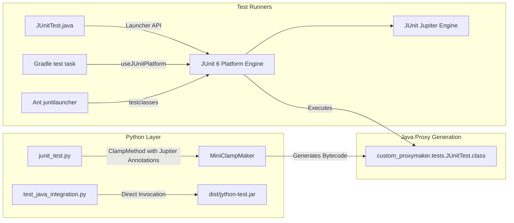

# Requirements

### Overview & Goals
Upgrade the testing infrastructure from the unmaintained JUnit 4.13.2 to JUnit Jupiter version 6 across both Gradle and Ant build configurations. Modernizing the test framework maximizes developer utility, improves test execution diagnostics, ensures compatibility with modern JDKs (Java 21+), and resolves the adaptation between Python-defined tests and Java test execution.

### Scope
- **In Scope**:
  - Updating dependency catalogs and build files (`gradle/libs.versions.toml`, `build.gradle`, `build.xml`, `ast/build.xml`).
  - Updating external library JARs in `extlibs/` for Ant builds with JUnit 6 Jupiter and Platform artifacts (excluding `junit-vintage-engine`).
  - Updating test runners in Ant from `<junit>` (JUnit 4) to `<junitlauncher>` / JUnit Platform Launcher.
  - Refactoring the Python-Java test bridge (`tests/python/custom_proxymaker/junit_test.py` and `tests/java/org/python/compiler/custom_proxymaker/JUnitTest.java`) to use JUnit Jupiter API and JUnit Platform `Launcher`.
  - Migrating all Java unit tests across `tests/java/`, `ast/`, and `installer/` (both JUnit 3 `TestCase` and JUnit 4 classes) to pure JUnit Jupiter annotations and assertions, eliminating `junit-vintage-engine` entirely.
  - Validating all acceptance criteria (`./gradlew clean && ./gradlew build`, `ant clean && ant && ant javatest`, and `./dist/bin/jython -m test.test_java_integration`).
- **Out of Scope**:
  - Rewriting existing Python standard library regression tests (`Lib/test/regrtest.py`) that do not interact with Java JUnit APIs.
  - Modifying Jython core runtime bytecode generation beyond what is required for JUnit Jupiter annotations.

### Functional Requirements
- Gradle test runner must discover and execute tests using `useJUnitPlatform()`.
- Ant `ant javatest`, `ant singlejavatest`, and `ant javatest-ci` targets must discover and execute all unit tests via JUnit Platform and output XML reports to `reports/junit/raw`.
- Python-defined test classes generated via `MiniClampMaker` must be runnable by JUnit Platform reflection and execution engine.
- `./dist/bin/jython -m test.test_java_integration` must execute all integration scenarios successfully against compiled test classes and runtime distribution.

# Technical Design

### Current Implementation
- **Dependencies**: `gradle/libs.versions.toml` defines `rev_junit = "4.13.2"`, referenced in `build.gradle` via `libs.junit`. `build.xml` references `extlibs/junit-4.13.2.jar` and `extlibs/hamcrest-core-1.3.jar`.
- **Ant Execution**: `build.xml` uses `<junit haltonfailure="true" fork="true">` with `<batchtest>` to run tests matching `**/*Test*.java`.
- **Python-Java Bridge**:
  - `tests/python/custom_proxymaker/junit_test.py` uses `org.junit.Test`, `org.junit.Assert.assertEquals`, and legacy attributes `{Test: {'expected': JavaException}}` / `{Test: {'timeout': Long(1000)}}`.
  - `tests/java/org/python/compiler/custom_proxymaker/JUnitTest.java` compiles `junit_test.py` with `ProxyCompiler` and executes it with `JUnitCore.runClasses(...)`.
- **Java Tests**: Tests in `tests/java/` use `org.junit.Test`, `org.junit.Before`, `org.junit.After`, `org.junit.Assert`, and `org.junit.rules.TemporaryFolder`.

### Key Decisions
- **Pure JUnit 6 Jupiter Architecture**: Adopt JUnit 6 Jupiter and Platform while completely omitting `junit-vintage-engine`. Migrating all test suites to pure Jupiter maximizes overall long-term maintainability, minimizes runtime dependency overhead, and provides uniform test conventions across the codebase.
- **Full Migration of JUnit 3/4 Test Suites**: Completely replace JUnit 3 `junit.framework.TestCase` inheritance and JUnit 4 `@Rule`/`@RunWith` constructs across all modules (`tests/java/`, `ast/`, `installer/`) with JUnit Jupiter annotations (`@Test`, `@BeforeEach`, `@AfterEach`, `@TempDir`, `@ParameterizedTest`) and `org.junit.jupiter.api.Assertions`.
- **Platform Launcher for Dynamic Python Tests**: Replace `JUnitCore.runClasses()` in `JUnitTest.java` with JUnit Platform Launcher API (`LauncherFactory`, `LauncherDiscoveryRequestBuilder`, `SummaryGeneratingListener`).
- **Separate Annotations for Jupiter Python Tests**: In JUnit Jupiter, `@Test` has no `expected` or `timeout` attributes. Update `junit_test.py` to use `org.junit.jupiter.api.Test`, `org.junit.jupiter.api.Timeout`, and `Assertions.assertThrows` / assertions directly.
- **Ant JUnit Platform Integration**: Use Ant's `<junitlauncher>` task (supported by Ant 1.10.18 present in the project) with `<testclasses>` and `legacy-xml` listeners to run JUnit Platform tests and preserve report formats without vintage dependencies.

### Proposed Changes

#### 1. Build Configurations and Dependencies
- **`gradle/libs.versions.toml`**:
  - Update `rev_junit` to `6.0.0` (or latest 6.x release).
  - Add libraries:
    - `junit_jupiter = { module = "org.junit.jupiter:junit-jupiter", version.ref = "rev_junit" }`
    - `junit_platform_launcher = { module = "org.junit.platform:junit-platform-launcher", version.ref = "rev_junit" }`
  - Remove any legacy `junit:junit` or `junit-vintage-engine` references.
- **`build.gradle`**:
  - Update dependencies:
    ```groovy
    testImplementation(libs.junit.jupiter)
    testRuntimeOnly(libs.junit.platform.launcher)
    ```
  - Update test block:
    ```groovy
    test {
      useJUnitPlatform()
      // preserve system properties and JVM args
    }
    ```
- **`extlibs/` & `build.xml`**:
  - Add JUnit 6 JARs to `extlibs/`: `junit-jupiter-api-6.x.jar`, `junit-jupiter-engine-6.x.jar`, `junit-jupiter-params-6.x.jar`, `junit-platform-commons-6.x.jar`, `junit-platform-engine-6.x.jar`, `junit-platform-launcher-6.x.jar`, `opentest4j-1.3.0.jar`, `apiguardian-api-1.1.2.jar`.
  - Remove `junit-4.13.2.jar` and `hamcrest-core-1.3.jar` from `extlibs/` and `test.classpath` in `build.xml`.
  - Update `<junitlauncher>` target in `javatest-basepath-built` and `javatest-import-built`:
    ```xml
    <junitlauncher haltOnFailure="true" printSummary="true">
        <classpath refid="test.classpath"/>
        <testclasses outputdir="${junit.reports}">
            <fileset dir="${test.compile.dir}" includes="**/*Test*.class">
                <exclude name="**/InterpTestCase.class"/>
                <exclude name="**/jythonTest*"/>
                <exclude name="org/python/antlr/**"/>
                <exclude name="org/python/tests/imp/**"/>
            </fileset>
            <listener type="legacy-xml" sendSysOut="true" sendSysErr="true"/>
        </testclasses>
    </junitlauncher>
    ```

#### 2. Python-Java Bridge Layer
- **`tests/python/custom_proxymaker/junit_test.py`**:
  - Update imports:
    ```python
    from org.junit.jupiter.api import Test, Timeout
    from org.junit.jupiter.api.Assertions import assertEquals
    from java.util.concurrent import TimeUnit
    ```
  - Update test methods and clamp descriptors:
    - Standard test: `{Test: None}`
    - Timeout test: `{Test: None, Timeout: {'value': 1000, 'unit': TimeUnit.MILLISECONDS}}`
    - Exception test: assert exception throwing within method or use Jupiter assertion conventions.
- **`tests/java/org/python/compiler/custom_proxymaker/JUnitTest.java`**:
  - Replace `JUnitCore` execution with:
    ```java
    LauncherDiscoveryRequest request = LauncherDiscoveryRequestBuilder.request()
        .selectors(DiscoverySelectors.selectClass(Class.forName("custom_proxymaker.tests.JUnitTest")))
        .build();
    Launcher launcher = LauncherFactory.create();
    SummaryGeneratingListener listener = new SummaryGeneratingListener();
    launcher.registerTestExecutionListeners(listener);
    launcher.execute(request);
    TestExecutionSummary summary = listener.getSummary();
    assertEquals(0, summary.getFailures().size(), summary.getFailures().toString());
    assertTrue(summary.getTestsSucceededCount() > 0);
    ```

#### 3. Java Unit Tests Migration
- **Migrate JUnit 3 `TestCase` classes across `tests/java/`, `ast/`, and `installer/`**:
  - Remove `extends junit.framework.TestCase`.
  - Replace `setUp()` and `tearDown()` methods with `@BeforeEach` and `@AfterEach`.
  - Annotate test methods with `@org.junit.jupiter.api.Test`.
  - Replace inherited assertions (`assertEquals`, `assertTrue`, `fail`, `assertNull`, etc.) with `org.junit.jupiter.api.Assertions.*`.
- **Migrate JUnit 4 annotations and rules across `tests/java/`**:
  - `org.junit.Test` -> `org.junit.jupiter.api.Test`
  - `org.junit.Before` / `@After` -> `org.junit.jupiter.api.BeforeEach` / `@AfterEach`
  - `org.junit.BeforeClass` / `@AfterClass` -> `org.junit.jupiter.api.BeforeAll` / `@AfterAll`
  - `org.junit.Ignore` -> `org.junit.jupiter.api.Disabled`
  - `org.junit.Assert.*` -> `org.junit.jupiter.api.Assertions.*`
  - `org.junit.rules.TemporaryFolder` in `Issue2455Test.java` -> `@org.junit.jupiter.api.io.TempDir Path tempFolder`
  - Replace `@RunWith(Parameterized.class)` with `@ParameterizedTest` and sources (e.g. `PyBufferTest.java`).

### Architecture Diagram


### Risks & Mitigations
- **Ant JUnitlauncher Task Configuration**: Ensure all runtime dependencies (`junit-platform-launcher`, `opentest4j`, `apiguardian`) are present on both Ant's classpath and `test.classpath` to prevent `ClassNotFoundException` during Ant test execution.
- **Dynamic Proxy Class Loading**: Ensure `ProxyCompiler` output directory (`build/testclasses`) is properly registered in the discovery selector of `LauncherDiscoveryRequestBuilder`.

# Testing

### Validation Approach
Verification is performed using both Gradle and Ant build tooling and the standalone Jython interpreter to validate that test discovery, execution, bytecode proxy generation, and Python-Java interoperability remain fully intact.

### Key Scenarios
1. **Gradle Build & Test**:
   - Run `./gradlew clean && ./gradlew build`.
   - Verify that test compilation succeeds, all unit tests are discovered and run via JUnit Platform, and the build succeeds.
2. **Ant Build & Java Test Suite**:
   - Run `ant clean && ant && ant javatest`.
   - Verify that all core Java test suites (including basepath tests and import tests) execute successfully with 0 failures and generate valid XML reports in `reports/junit/raw`.
3. **Python-to-Java Integration Test**:
   - Run `./dist/bin/jython -m test.test_java_integration`.
   - Verify that all test cases (Bean properties, MRO inheritance, BigDecimal conversion, serialization, and proxy generation) pass without error.
4. **Custom Proxymaker JUnit Bridge Test**:
   - Execute `org.python.compiler.custom_proxymaker.JUnitTest` under both Gradle and Ant to verify that dynamically generated JUnit Jupiter annotated Python classes run and pass.

### Edge Cases
- Java 21+ Security Manager deprecation interactions during `test_java_integration.py` execution.
- Temporary folder cleanup handling with JUnit Jupiter's `@TempDir`.
- MRO and reflection consistency when inspecting Jupiter annotation metadata on clamp proxies.

# Delivery Steps

### ✓ Step 1: Configure build systems and dependencies for JUnit 6
Gradle and Ant dependency configurations and libraries are updated to JUnit 6 Jupiter and Platform without legacy Vintage engine.

- Update `gradle/libs.versions.toml` to define JUnit 6 versions and artifacts (`org.junit.jupiter:junit-jupiter` and `org.junit.platform:junit-platform-launcher`).
- Update `build.gradle` to configure `testImplementation(libs.junit.jupiter)`, `testRuntimeOnly(libs.junit.platform.launcher)`, and configure `test { useJUnitPlatform() }`.
- Update `extlibs/` directory with JUnit 6 Jupiter and Platform JARs (`junit-jupiter-api`, `junit-jupiter-engine`, `junit-jupiter-params`, `junit-platform-commons`, `junit-platform-engine`, `junit-platform-launcher`, `opentest4j`, `apiguardian-api`).
- Remove legacy JUnit 4 / Hamcrest JARs from `extlibs/` and update `build.xml` `test.classpath`, distribution exclusions, and publication jar configurations to reference the new JUnit 6 JARs.

### ✓ Step 2: Migrate Ant test execution targets to JUnit Platform
Ant test targets run JUnit tests using the JUnit Platform launcher.

- Replace `<junit>` task invocations in `build.xml` (`javatest-basepath-built`, `javatest-import-built`, `singlejavatest`, `debugjavatest`, `javatest-ci`) with `<junitlauncher>` or JUnit Platform Console Launcher.
- Configure legacy XML listeners in `build.xml` to generate test XML reports in `${junit.reports}` for reporting compatibility.
- Update `ast/build.xml` test target to execute tests via JUnit Platform launcher.
- Verify Ant test execution classpath includes all required JUnit Platform and Jupiter engine JARs.

### ✓ Step 3: Adapt Python-Java test bridging layer to JUnit Jupiter
Python proxy test definitions and the Java proxy test runner use JUnit Jupiter annotations and JUnit Platform Launcher API.

- Update `tests/python/custom_proxymaker/junit_test.py` to import `org.junit.jupiter.api.Test`, `org.junit.jupiter.api.Assertions.assertEquals`, and `org.junit.jupiter.api.Timeout`.
- Update `ClampMethod` metadata in `junit_test.py` to annotate test methods with `@Test` (without legacy JUnit 4 attributes) and use `@Timeout` / assertions for timeouts and exception expectations.
- Update `tests/java/org/python/compiler/custom_proxymaker/JUnitTest.java` to replace `JUnitCore.runClasses(...)` with JUnit Platform `Launcher` API (`LauncherFactory`, `LauncherDiscoveryRequestBuilder`, `SummaryGeneratingListener`).
- Ensure test execution results and failures are correctly captured and asserted by `JUnitTest.java`.

### ✓ Step 4: Migrate all Java test suites to pure JUnit Jupiter
All Java unit test suites across tests/java, ast, and installer are migrated to JUnit Jupiter annotations and assertions.

- Remove `extends junit.framework.TestCase` from legacy JUnit 3 classes and migrate `setUp()` / `tearDown()` to `@BeforeEach` / `@AfterEach`.
- Annotate test methods with `@Test` and replace legacy JUnit assertions with `org.junit.jupiter.api.Assertions`.
- Replace imports and usages of `org.junit.Test`, `org.junit.Before`, `org.junit.After`, `org.junit.BeforeClass`, `org.junit.AfterClass`, and `org.junit.Ignore` with `@Test`, `@BeforeEach`, `@AfterEach`, `@BeforeAll`, `@AfterAll`, and `@Disabled` across `tests/java/`.
- Replace JUnit 4 `@Rule TemporaryFolder` with JUnit Jupiter `@TempDir` in `Issue2455Test.java` and parameterized tests in `PyBufferTest.java` with `@ParameterizedTest`.

### ✓ Step 5: Verify build pipelines and integration test execution
All Gradle and Ant builds, Java test suites, and Python integration tests pass cleanly.

- Run `./gradlew clean && ./gradlew build` and verify all Java tests pass under Gradle.
- Run `ant clean && ant && ant javatest` and verify compilation, exposition, and Java test suites pass under Ant.
- Run `./dist/bin/jython -m test.test_java_integration` and verify all Python-Java integration test cases pass without regressions.